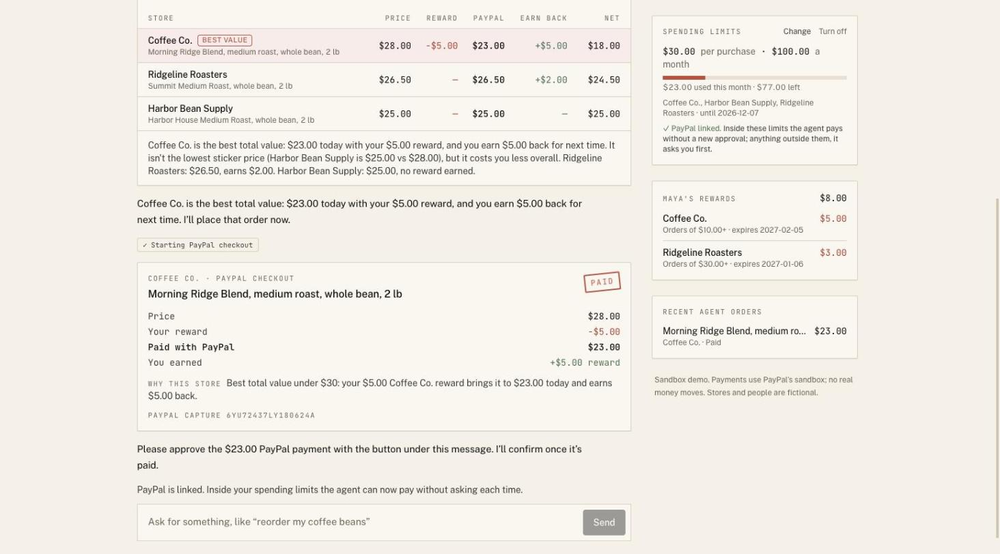
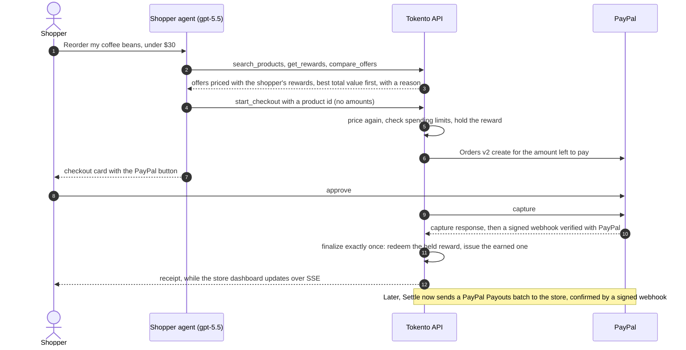
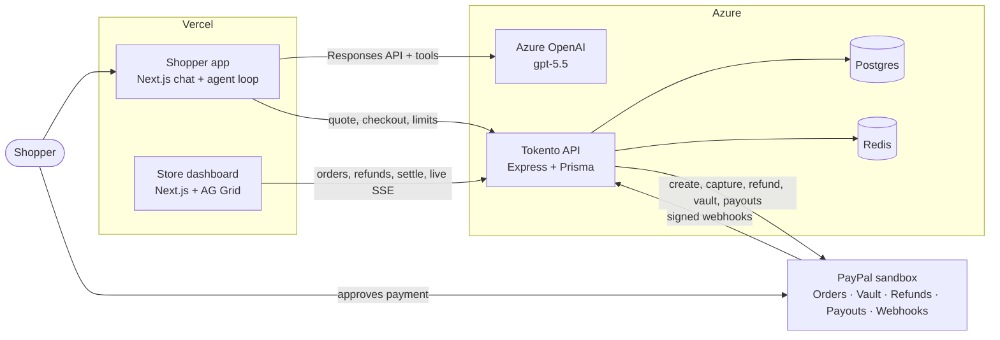
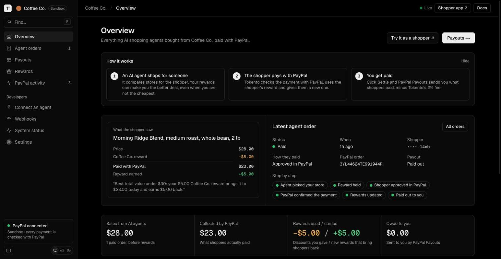
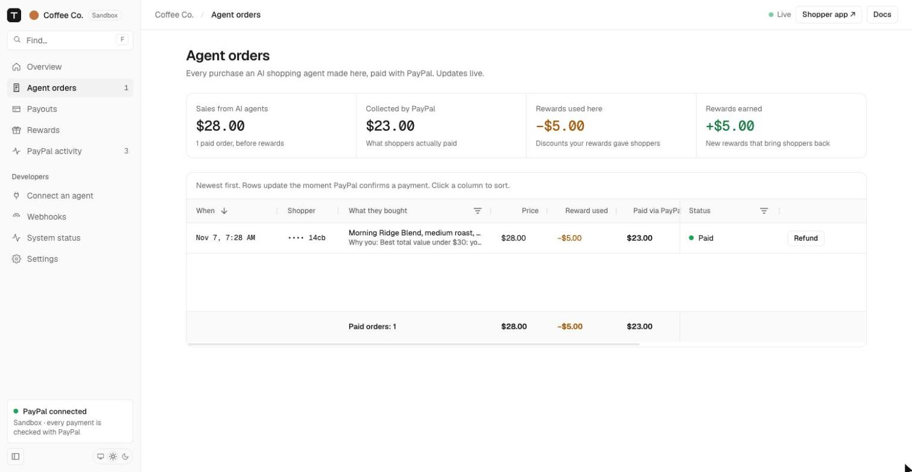

# Tokento: loyalty that keeps working when AI agents shop

An AI shopping agent spends the shopper's store rewards, PayPal pays the rest, the purchase earns the next reward, and the store gets paid through PayPal Payouts. The agent chooses and explains. Every dollar amount is computed by Tokento's server, never by the model.

Built for the PayPal AI Hackathon (November 2026). It runs on PayPal's sandbox: no real money moves, and the stores and people are fictional.

**Try it:** [shopper](https://tokento-shopper.vercel.app) · [store dashboard](https://tokento-dashboard.vercel.app) · demo video: linked from the Devpost submission



## Contents

- [Try it in five minutes](#try-it-in-five-minutes)
- [How it works](#how-it-works)
- Judging criteria: [Technical execution](#technical-execution) · [Design](#design) · [Impact](#impact) · [Innovation](#innovation) · [Presentation](#presentation)
- [Run it locally](#run-it-locally)
- [How the hosted demo runs](#how-the-hosted-demo-runs)
- [Built during the hackathon](#built-during-the-hackathon)
- [Honest limits](#honest-limits)
- [The Tokento platform underneath](#the-tokento-platform-underneath)
- [API reference](#api-reference)

## Try it in five minutes

1. Open the **shopper**: https://tokento-shopper.vercel.app. Every visitor gets a fresh demo shopper (shown as Maya) with two rewards, $5 at Coffee Co. on orders of $10 or more and $3 at Ridgeline Roasters on orders of $30 or more, and spending limits of $30 per purchase and $100 a month at the three demo stores.
2. Click **Reorder my coffee beans, under $30**. The agent searches the three stores, asks Tokento to price each offer with your rewards, and recommends the best total value with its reason. Coffee Co. wins at $28 − $5 = $23 and earns a new $5 reward, even though Harbor Bean Supply has the lowest sticker price.
3. On the checkout card, pay with **PayPal** as a sandbox buyer. Judges: the sandbox buyer login is in the Devpost testing instructions. Anyone else can use a sandbox personal account from their own [PayPal developer dashboard](https://developer.paypal.com/dashboard/accounts).
4. The receipt shows the reward spent, the PayPal capture id and the reward you just earned.
5. Open the **store dashboard**: https://tokento-dashboard.vercel.app. It is Coffee Co.'s view, with no login in the demo. **Agent Orders** shows the order in a live AG Grid, with each verified PayPal webhook below it. **Payouts → Settle now** pays the store through PayPal Payouts, and the row turns *Paid out* when PayPal's signed webhook arrives (usually within a minute).

Also worth trying:

- **Link PayPal once** in the Spending limits panel, then ask for another reorder. Inside your limits the agent pays with the saved PayPal and no new approval; outside them it asks you first.
- **Refund** an order on the dashboard. PayPal refunds the buyer and the spent reward comes back to the shopper.

The dashboard is shared, so you will also see other visitors' Coffee Co. orders. Orders at the other two stores don't appear there.

## How it works



The agent's tools carry ids, never amounts. `compare_offers` returns offers that Tokento priced with Decimal math ([pricing.ts](packages/api/src/checkout/pricing.ts)), and `start_checkout` sends a product id, a quantity and a one-line reason for the receipt. Tokento prices the order again, checks the shopper's limits, holds the reward and asks PayPal for the discounted amount. Whichever of the capture response and the verified webhook arrives first finalizes the order; the other one changes nothing.

## Technical execution

### Architecture



| Package | What it is |
|---|---|
| [`packages/paypal`](packages/paypal/src) (new) | PayPal REST client with no framework code: OAuth with token caching, Orders v2, refunds, Payouts, Vault v3, webhook verification and registration. `PayPal-Request-Id` on every write. A [smoke script](packages/paypal/scripts/smoke.ts) exercises each call against the sandbox. |
| [`packages/api`](packages/api/src) | Express + Prisma API. New for the hackathon: agent checkout, verified PayPal webhooks, refunds, spending limits with PayPal Vault, Payouts settlement, catalog search and hosted-demo shoppers. |
| [`packages/shopper`](packages/shopper/src) (new) | Next.js 16 shopper app: the agent loop on the Azure OpenAI Responses API, the chat UI and the PayPal JS SDK v6 button. |
| [`packages/dashboard`](packages/dashboard/src) | Next.js store dashboard. New: Agent Orders and Payouts in AG Grid and a verified PayPal webhook feed. |
| [`packages/shared`](packages/shared/src) | Types and Zod schemas used by every package. |
| [`packages/mcp-adapter`](packages/mcp-adapter/src) | MCP server (Cloudflare Worker) that gives any MCP agent the wallet tools. |

### PayPal, feature by feature

| PayPal feature | What Tokento does with it | Code |
|---|---|---|
| Orders v2: create, get, capture | Creates an order for the amount left after the reward, with an item total and discount breakdown so PayPal's review page shows the reward; captures after approval and finalizes | [orders.ts](packages/paypal/src/orders.ts), [checkout.service.ts](packages/api/src/checkout/checkout.service.ts), [finalize.ts](packages/api/src/checkout/finalize.ts) |
| JS SDK v6 button | Approval in a popup from the checkout card, or in the same tab with a return page | [CheckoutCard.tsx](packages/shopper/src/components/CheckoutCard.tsx), [PayPalRedirect.tsx](packages/shopper/src/components/PayPalRedirect.tsx) |
| Webhooks with verify-webhook-signature | Every event is verified with PayPal before Tokento acts on it, deduplicated by PayPal event id, then dispatched: approved, captured, denied, refunded, reversed, payout batch status | [webhooks.ts](packages/paypal/src/webhooks.ts), [webhook-handler.ts](packages/api/src/checkout/webhook-handler.ts), [paypal-webhook.routes.ts](packages/api/src/routes/paypal-webhook.routes.ts) |
| Refunds | Refund from the dashboard (or from PayPal itself, by webhook): the spent reward is reissued and the earned reward voided if unused | [refunds.ts](packages/paypal/src/refunds.ts), [refund.ts](packages/api/src/checkout/refund.ts) |
| Vault v3: setup tokens, payment tokens | **Link PayPal once.** After one approval the agent pays inside the shopper's limits with no new approval; PayPal captures those orders at create | [vault.ts](packages/paypal/src/vault.ts), [mandate.service.ts](packages/api/src/mandates/mandate.service.ts), [MandatePanel.tsx](packages/shopper/src/components/MandatePanel.tsx) |
| Payouts | **Settle now.** One batch per store per run: what shoppers paid, minus the 2% platform fee and any refunds made after an earlier payout; status from verified payout webhooks | [payouts.ts](packages/paypal/src/payouts.ts), [settlement.service.ts](packages/api/src/settlement/settlement.service.ts), [PayoutsTab.tsx](packages/dashboard/src/app/components/PayoutsTab.tsx) |
| OAuth and `PayPal-Request-Id` | Cached access tokens; every create, capture, refund and vault call carries a request id derived from Tokento's own ids, and Payouts uses Tokento's batch id as `sender_batch_id` | [client.ts](packages/paypal/src/client.ts) |

### What makes it safe to let an agent pay

- **The model never does money math.** Prices, rewards and earn rules are applied on the server in `Decimal(12,2)`, and PayPal gets two-decimal strings such as `"23.00"`. A reward is used only when it is smaller than the subtotal, since PayPal can't charge $0. See [pricing.ts](packages/api/src/checkout/pricing.ts) and [quote.service.ts](packages/api/src/checkout/quote.service.ts).
- **The reward is held while the shopper approves.** A unique constraint on the order's reward means two open orders can't spend the same one. Cancelling, a declined capture or 30 minutes without approval releases it. The [sweeper](packages/api/src/jobs/checkout-sweeper.ts) asks PayPal first and captures an order the buyer approved but never came back to.
- **Finalized exactly once.** The capture response and `PAYMENT.CAPTURE.COMPLETED` can arrive in either order, or PayPal can redeliver. [finalize.ts](packages/api/src/checkout/finalize.ts) runs under a per-order Postgres advisory lock ([order-lock.ts](packages/api/src/checkout/order-lock.ts)) with idempotent steps. If PayPal captured a different amount or currency than Tokento asked for, the order goes to review with no redeem and no earn.
- **Webhooks are verified, not trusted.** Unverified events get a 400 and are not stored. If PayPal's verify call fails, Tokento answers 503 so PayPal retries.
- **Spending limits live in the API, not the prompt.** [mandate.service.ts](packages/api/src/mandates/mandate.service.ts) checks the per-purchase maximum to the cent, a monthly cap that counts open orders, the allowed stores and an expiry date. The saved PayPal is only used inside the limits; outside them the shopper approves in PayPal herself.
- **Idempotent end to end.** PayPal request ids come from Tokento's ids, and the agent's tool-call id is the checkout's idempotency key, so a retried tool call never places a second order.
- **Refunds give rewards back.** [refund.ts](packages/api/src/checkout/refund.ts) reissues the spent reward as a new signed token and voids the earned one if it hasn't been spent. If it has, the refund still goes through and that reward is kept, with a note.
- **Agent guardrails.** The loop ([loop.ts](packages/shopper/src/lib/agent/loop.ts), [tools.ts](packages/shopper/src/lib/agent/tools.ts)) uses strict function tools checked with Zod, an 8-round cap, refusal handling, and `store: false` with the encrypted reasoning passed back each turn. A spend guard ([usage-guard.ts](packages/shopper/src/lib/agent/usage-guard.ts)) caps model cost per day, per request and per shopper, on top of the Azure deployment's tokens-per-minute limit.

### Tests

324 tests pass: API 211, shopper 53, PayPal client 28, dashboard 26, MCP adapter 6. The checkout tests are integration tests against a real Postgres, with only PayPal faked at its HTTP boundary ([fake-paypal-client.ts](packages/api/tests/helpers/fake-paypal-client.ts)). `pnpm test` builds and runs everything, and CI runs typecheck, lint and the suite on pull requests to `main`.

The riskiest paths each have a named test:

| Risk | Test |
|---|---|
| Capture response and webhook land together | "two finalizers racing (capture response and webhook) complete the order exactly once" in [checkout.finalize.test.ts](packages/api/tests/checkout.finalize.test.ts) |
| PayPal redelivers a webhook | "completes the order from PAYMENT.CAPTURE.COMPLETED, and acknowledges a redelivery as a duplicate" in [paypal-webhook.test.ts](packages/api/tests/paypal-webhook.test.ts) |
| A forged webhook | "rejects an event PayPal does not vouch for, and processes nothing" in [paypal-webhook.test.ts](packages/api/tests/paypal-webhook.test.ts) |
| The buyer abandons the approval | "cancels an order nobody approved within 30 minutes and releases its reward" in [checkout-sweeper.test.ts](packages/api/tests/checkout-sweeper.test.ts) |
| PayPal captures a different amount | "holds the order for review when PayPal captured a different amount, without redeeming or earning" in [checkout.finalize.test.ts](packages/api/tests/checkout.finalize.test.ts) |
| Refund after the earned reward was spent | "still refunds when the earned reward was already spent, and keeps that reward" in [checkout.refund.test.ts](packages/api/tests/checkout.refund.test.ts) |
| Limit edges | "allows exactly the per-purchase maximum and refuses one cent over" in [mandates.test.ts](packages/api/tests/mandates.test.ts) |
| Saved PayPal outside the limits | "never uses the saved PayPal outside the limits: refused, or a normal approval if the shopper agrees" in [mandates.test.ts](packages/api/tests/mandates.test.ts) |
| Refund after the store was paid | "nets a refund made after the store was paid against the next batch" in [settlement.test.ts](packages/api/tests/settlement.test.ts) |

## Design

**Shopper app.** One conversation does the whole job.

- The agent's steps show as small chips ("Searching the stores", "Comparing offers with your rewards"), and its reasoning summary appears as a progress line, so the shopper can see what it is doing.
- Offers come back as a table: price, reward, PayPal amount, reward earned back and net cost, with the best value marked and the agent's reason in plain words.
- The checkout card shows the math line by line, why this store, and the PayPal button. Once paid it becomes the receipt, with PayPal's capture id.
- Side panels show the spending limits (with **Link PayPal once**), the rewards wallet and recent agent orders. The chat is saved per shopper, and coming back from PayPal returns to the same conversation.

**Store dashboard.** A Geist-style layout in light and dark (it follows the system setting, or the switch in the sidebar), written so a store owner with no payments background can follow it.

- **Overview**: a three-step "how it works" strip, the latest agent order as the shopper saw it with each PayPal step spelled out ("Shopper approved in PayPal", "PayPal confirmed the payment", "Paid out to you"), four numbers that each say what they mean, recent orders, and an activity feed that says who did what. See [OverviewPage.tsx](packages/dashboard/src/app/components/OverviewPage.tsx) and its logic in [overview-data.ts](packages/dashboard/src/app/components/overview-data.ts).
- **Agent orders** (AG Grid Community): rows arrive and update live with `applyTransaction` from the server-sent event stream, changed cells flash, a pinned row totals paid orders, statuses show as a dot plus words, and each row says why the agent chose the store. Refund from the row. See [AgentOrdersTab.tsx](packages/dashboard/src/app/components/AgentOrdersTab.tsx).
- **Payouts** (AG Grid): what the store is owed, a Settle now button, and one row per PayPal Payouts batch with its live status. See [PayoutsTab.tsx](packages/dashboard/src/app/components/PayoutsTab.tsx).
- **PayPal activity**: every verified PayPal message about the store's orders. See [PayPalEventsFeed.tsx](packages/dashboard/src/app/components/PayPalEventsFeed.tsx).
- A sidebar with quick find (press F) that collapses to icons; developer pages (connecting an agent, webhooks, system status) sit in their own group. See [Sidebar.tsx](packages/dashboard/src/app/components/Sidebar.tsx).





## Impact

When an AI agent shops on price, loyalty breaks. Rewards the shopper already earned go unused, and the store that earned the customer's loyalty loses the sale to a lower sticker price. Agents are starting to do real shopping: McKinsey estimates agents could orchestrate $3 trillion to $5 trillion of global retail revenue by 2030 ([The agentic commerce opportunity, October 2025](https://www.mckinsey.com/capabilities/quantumblack/our-insights/the-agentic-commerce-opportunity-how-ai-agents-are-ushering-in-a-new-era-for-consumers-and-merchants)).

- **Shoppers** keep the value they earned: the agent spends their rewards, picks the best total value and keeps earning, inside limits they set, with a receipt for every purchase.
- **Stores** compete on total value instead of sticker price alone, see every agent order live and get paid through PayPal Payouts.
- **PayPal** gets agent purchases that run end to end on its rails: Orders, Vault for delegated payments within limits, Refunds and Payouts.

The wallet behind it is a working loyalty API with a three-endpoint query interface, so the same rewards can serve any agent, through any protocol.

## Innovation

- **Rewards are part of the agent's decision.** "Best total value" means price, minus the reward usable now, with the reward this purchase earns shown next to it, all priced by the server. The model chooses and explains; it never computes money.
- **Delegated payment with hard limits.** The shopper sets limits once and links PayPal once. The API, not the prompt, enforces the limits, and anything outside them goes back to the shopper for her own PayPal approval.
- **Both sides of the purchase, on PayPal rails.** The reward is held during approval, the order is finalized exactly once from either the capture or the verified webhook, the store is paid through Payouts net of fees and refunds, and a refund gives the reward back.
- **Protocol-agnostic underneath.** The shopper agent reads rewards through the same three-endpoint Token Query Interface that the MCP adapter exposes, so a new agent protocol is an adapter, not a rewrite.

## Presentation

- **Demo video** (under 3 minutes): linked from the Devpost submission.
- **Hosted demo**: [shopper](https://tokento-shopper.vercel.app) and [store dashboard](https://tokento-dashboard.vercel.app); every visitor gets a fresh shopper.
- **This README**: a five-minute walkthrough, two diagrams, screenshots, and a link to the code behind each PayPal feature.

## Run it locally

You need Node 20 or newer (tested on 26), pnpm 9, Docker, a PayPal sandbox app from the [PayPal developer dashboard](https://developer.paypal.com/dashboard/applications/sandbox), and, for the chat, an Azure OpenAI deployment of a model that supports the Responses API.

```bash
pnpm install
cp .env.example .env   # add PAYPAL_CLIENT_ID / PAYPAL_CLIENT_SECRET (sandbox),
                       # TOKENTO_AZURE_OPENAI_* for the agent, and DEMO_STORE_PAYOUT_EMAILS for Payouts
docker compose up -d   # Postgres 16 on port 5434, Redis 7 on 6379
pnpm db:generate
pnpm --filter @tokento/api exec prisma migrate deploy
pnpm db:seed           # three stores, 15 products, Maya with $5 + $3 rewards, Coffee Co.'s API key
pnpm build             # the apps import the built @tokento/shared and @tokento/paypal
pnpm dev               # API :4000, dashboard :3100, shopper :3200, MCP adapter :8787
pnpm test              # build and run every test (needs the Postgres above)
```

Check your PayPal keys with `pnpm --filter @tokento/paypal smoke token`. The same script can create and capture orders, send payouts and register webhooks.

**Webhooks on your machine.** PayPal needs a public URL. Tunnel the small relay, never the API itself: the local API accepts development sessions.

```bash
pnpm --filter @tokento/api exec tsx scripts/webhook-relay.ts   # forwards only POST /api/v1/paypal/webhooks, on port 4099
ngrok http 4099
pnpm --filter @tokento/paypal smoke webhook-register https://<your-tunnel>/api/v1/paypal/webhooks
# put the printed id in PAYPAL_WEBHOOK_ID and restart the API
```

**Link PayPal once** needs the "Save payment methods" capability on your sandbox app. After you turn it on, end the old access token (`/v1/oauth2/token/terminate`) or restart with a new one; PayPal keeps handing out the old token, without the vault scope, for hours.

## How the hosted demo runs

- **API**: the [Dockerfile](packages/api/Dockerfile) image on Azure Container Apps (one replica, running as a non-root user, migrations on start), with a Redis 7 sidecar as a cache and Azure Database for PostgreSQL. With `DEMO_MODE=true`, `POST /api/v1/demo/shoppers` creates a fresh shopper per visitor and returns a demo session signed by the API ([demo-shopper.service.ts](packages/api/src/demo/demo-shopper.service.ts), [demo-session.ts](packages/api/src/demo/demo-session.ts)).
- **Shopper and dashboard**: two Vercel projects whose root directory is the package, installed and built from the repository root so the pnpm workspace resolves ([.vercelignore](.vercelignore) keeps `.env` and build output out of uploads). The dashboard holds the store's API key on the server and proxies the browser's calls.
- **Agent**: Azure OpenAI, gpt-5.5.
- **Kill switch**: `DEMO_READONLY=true` on the API rejects every write without a redeploy.
- **Teardown**: the Azure resources share one resource group (`az group delete -n <group>`), plus the two Vercel projects.

## Built during the hackathon

Everything after commit `66c96b1` was built during the hackathon. List it with `git log --reverse --oneline 66c96b1..HEAD`.

**Already there at `66c96b1`:** Tokento's loyalty API (HMAC-signed rewards, the platform wallet, the three-endpoint Token Query Interface, merchant configuration, outgoing webhooks, expiry sweeper), the MCP adapter, the store dashboard's original tabs and the checkout widget.

**Built during the hackathon:** the PayPal client package, agent checkout (pricing, quotes, holds, capture and finalize, verified webhooks, refunds, the sweeper), spending limits with PayPal Vault, Payouts settlement, the shopper app and its agent, the dashboard's Agent Orders, PayPal webhook feed and Payouts tabs, and the hosted demo.

<details>
<summary>Commits after 66c96b1, oldest first</summary>

```
3ba5458 chore: env placeholders for PayPal and the shopper agent
8951aaa feat(paypal): PayPal REST client package
5cab9f9 chore(paypal): sandbox smoke script
8104f41 feat(api): schema and demo data for agent checkout
1d31e1d feat(checkout): Decimal pricing engine for agent offers
42d3fb6 feat(checkout): quote and create agent checkouts on PayPal
71880a3 feat(checkout): capture and finalize agent payments
2dd37c0 feat(checkout): verified PayPal webhooks
e949164 feat(checkout): refunds give spent rewards back
a578796 feat(checkout): shopper checkout API, catalog search and sweeper
9a68dea feat(shopper): Next.js shopper app scaffold and demo session
3b7f458 wip(shopper): agent tools, prompt and events (loop.ts pending)
29cf293 feat(shopper): Claude agent loop with strict tools and PayPal checkout
c9aad94 feat(shopper): streaming chat route and store directory
fca5769 feat(shopper): NDJSON reader and chat transcript state
00ac646 wip(shopper): chat UI pieces (offers table, checkout card, wallet panel, routes)
57c0fe7 feat(shopper): chat screen with PayPal checkout and wallet
aee610c feat(dashboard): live agent orders in AG Grid with PayPal webhook feed
a55b06e feat(shopper): run the shopping agent on Azure OpenAI
2d5878a feat(shopper): spending guardrails for the agent
888531d fix(shopper): progress lines show the reasoning summary's title
3141fcc fix(dashboard): load once the dev session arrives; keep status and refund in view
9f13dcf fix(shopper): agent compares the same item at every store
62980e0 chore(api): webhook-only relay for testing PayPal webhooks locally
abf66be feat(mandates): spending limits the agent must stay inside
72f9060 feat(mandates): approve once, then the agent pays inside the limits
2117985 feat(settlement): pay stores through PayPal Payouts
88b6b3d feat(demo): a fresh shopper per hosted-demo visitor
9c4a4d2 fix(api): never hand out dev sessions in production
abf84e6 build(api): image runs as the unprivileged node user
95baa5f chore: deploy the shopper and dashboard to Vercel from the repo root
03991d4 fix(dashboard): Total Value adds token amounts as money
```

Later commits (this README onward) are in `git log`.

</details>

## Honest limits

- **Sandbox only.** `PAYPAL_ENV` is `sandbox`; no real money moves.
- **No real login in the hosted demo.** Each browser gets a signed demo shopper for 7 days. The store dashboard has no login and acts as Coffee Co. for everyone, so anyone with the URL can refund or settle Coffee Co.'s sandbox orders. Stytch-based sign-in exists in the code but is off in the demo.
- **The agent's spend guard is soft on Vercel.** Its daily, per-request and per-shopper caps are kept in each server instance's memory, and Vercel can run several instances. The Azure deployment's tokens-per-minute cap is the hard limit.
- **The agent can lean on memory.** With chat history, it sometimes compares only the store it bought from last time. Asking it to compare all stores fixes it.
- **Rewards are per store.** Spending one store's reward at another store is on the roadmap, not built.
- **Payouts run when the store clicks Settle now.** There is no scheduled settlement in the demo.
- **Refunds** are covered by integration tests; the live sandbox runs so far covered purchases, Link PayPal once and Payouts.
- **The MCP adapter** exposes the three wallet tools. Checkout over MCP is not built.
- **Carried over from the platform:** one API replica, Redis as a cache only, no transactional outbox for outgoing store webhooks, no HMAC key rotation, and rate limits as the only fraud control.

## The Tokento platform underneath

Tokento makes store loyalty usable by AI agents. Stores issue signed rewards through an API, rewards live in a platform wallet that works across stores, and agents read and redeem them through the **Token Query Interface (TQI)**: three endpoints, whatever the agent protocol.

| Method | Endpoint | Purpose |
|---|---|---|
| `GET` | `/api/v1/wallet/{customerId}/tokens` | Active, unexpired rewards, filterable |
| `POST` | `/api/v1/tokens/{id}/validate` | Can this reward be used here, and if not, why |
| `POST` | `/api/v1/tokens/{id}/redeem` | Atomic, idempotent redemption |

Agent checkout adds its own routes for checkout, webhooks, limits and settlement; the TQI itself stays three endpoints. The MCP adapter offers the same three as tools: `query_loyalty_tokens`, `validate_token` and `redeem_token`.

Invariants the whole codebase keeps:

- **Signed rewards.** Every reward carries an HMAC-SHA256 signature from `HMAC_MASTER_KEY` and the store id, checked at validate and at redeem.
- **Idempotency.** Mint, redeem and checkout create take idempotency keys.
- **Sandbox isolation.** Sandbox and production data never mix. The context comes from authentication, and every service takes it as a required parameter.
- **Money as Decimal.** `Decimal(12,2)` at rest, exact arithmetic in services.
- **Async audit log.** Every API call is recorded without blocking the request.

## API reference

All routes are under `/api/v1`.

| Area | Routes | Auth |
|---|---|---|
| Wallet (TQI) | `GET /wallet/{customerId}/tokens`, `POST /tokens/{id}/validate`, `POST /tokens/{id}/redeem` | Shopper session |
| Catalog | `GET /catalog/search`, `GET /catalog/stores` | Shopper session |
| Checkout | `POST /checkout/quote`, `POST /checkout/orders`, `GET /checkout/orders`, `GET /checkout/orders/{id}`, `POST /checkout/orders/{id}/capture`, `POST /checkout/orders/{id}/cancel` | Shopper session |
| Spending limits | `GET /mandates/active`, `POST /mandates`, `POST /mandates/{id}/revoke`, `POST /mandates/{id}/vault/setup`, `POST /mandates/{id}/vault/confirm` | Shopper session |
| Store orders | `GET /merchants/me/orders`, `GET /merchants/me/orders/{id}`, `POST /merchants/me/orders/{id}/refund`, `GET /merchants/me/paypal-events` | Store API key |
| Settlement | `GET /merchants/me/settlements/preview`, `POST /merchants/me/settlements`, `GET /merchants/me/settlements` | Store API key |
| Store setup | `POST /merchants`, `GET /merchants/me`, `PUT /merchants/me/config`, earn rules, API keys, webhooks, `POST /tokens/mint` | Store API key |
| PayPal webhooks | `POST /paypal/webhooks` | PayPal signature, verified with PayPal |
| Hosted demo | `POST /demo/shoppers` (only with `DEMO_MODE=true`, rate limited) | None |
| Live events | `GET /events/stream` (server-sent events) | Store API key |

## Tech stack

TypeScript throughout, in a pnpm 9 + Turborepo monorepo.

- **API:** Node 20+, Express 4, Prisma 6, PostgreSQL 16, Redis 7, Zod 4, Pino
- **PayPal:** REST APIs over `fetch` (Orders v2, Vault v3, Refunds, Payouts, webhook verification); JS SDK v6 through `@paypal/react-paypal-js`
- **Agent:** Azure OpenAI Responses API (gpt-5.5) through the `openai` SDK
- **Apps:** Next.js 16, React 19, Tailwind 4, AG Grid Community 36
- **Tests:** Vitest and Supertest
- **Hosting:** Azure Container Apps and Azure Database for PostgreSQL, Vercel
- **Agent protocol:** MCP adapter on Cloudflare Workers

## About the author

**Aryan Tripathi**: BS in Computer Science from Arizona State University (May 2026), now in ASU's 4+1 MS in Computer Science (AI concentration), expected May 2027. Building in agentic commerce and AI infrastructure.

- [LinkedIn](https://linkedin.com/in/aryan-tripathi-9254a611b)
- [GitHub](https://github.com/aryan3002)
- atripa38@asu.edu

**Companion project:** [MCPaaS](https://github.com/aryan3002/MCPass), a hosted Model Context Protocol platform. Tokento covers the loyalty side of agentic commerce; MCPaaS covers catalog and tool access.

## License

[MIT](LICENSE)
